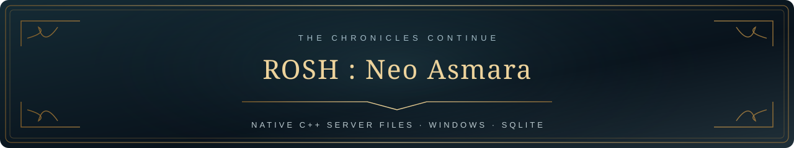
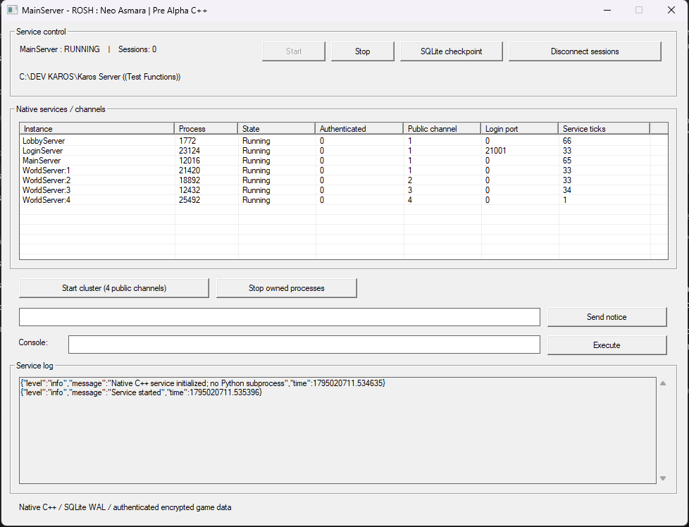
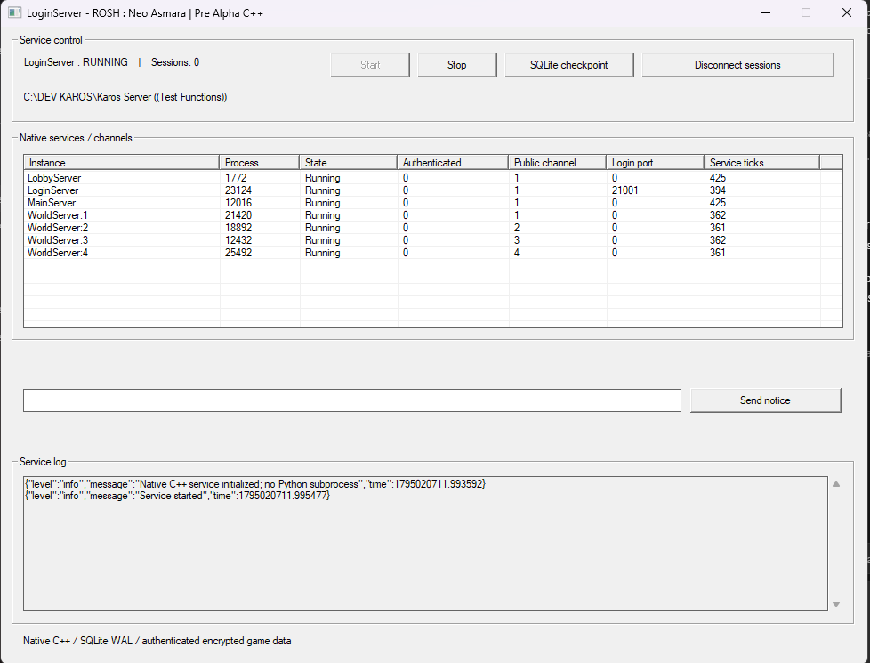
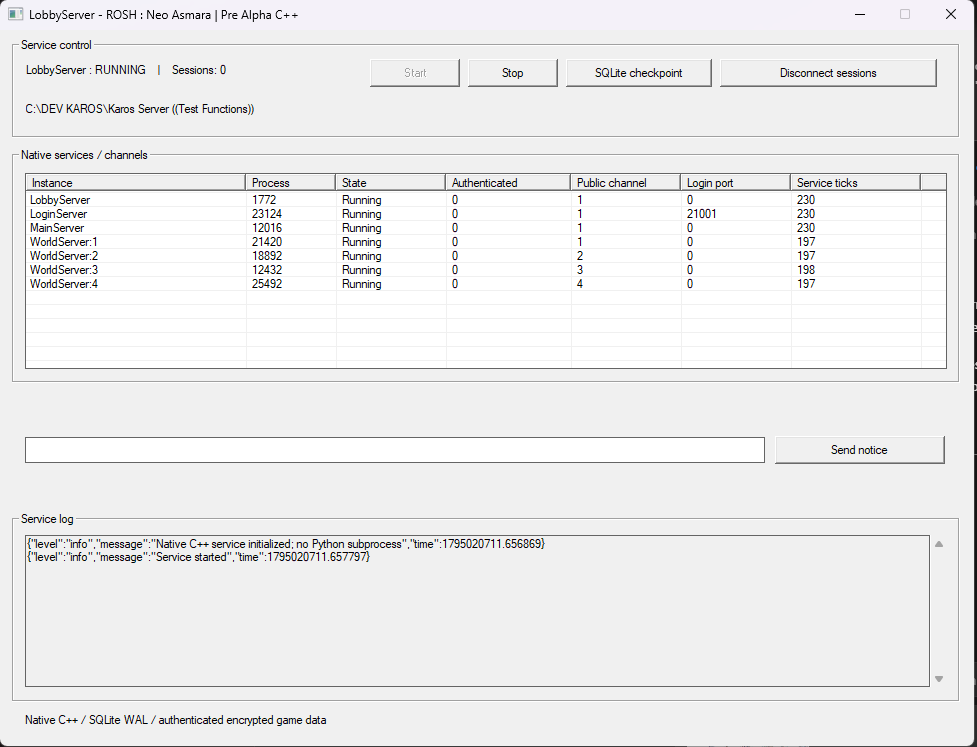
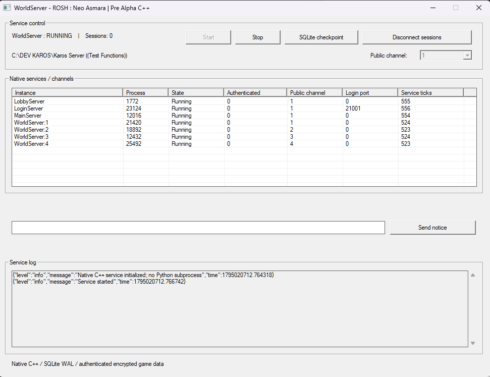

<p align="center">
  
</p>

# Neo Asmara Core++

Precompiled Windows server files for the **ROSH: Neo Asmara development preview**.

The server is built using **native C++ and SQLite**, with a preconfigured local environment and four-channel server cluster.

**Source code is not included in this distribution.**

<p align="center">
  <a href="#quick-start">Quick Start</a> ·
  <a href="#server-panels">Server Panels</a> ·
  <a href="#installation-guide">Installation Guide</a> ·
  <a href="#configuration">Configuration</a> ·
  <a href="#troubleshooting">Troubleshooting</a> ·
  <a href="#license">License</a>
</p>

---

## Quick Start

NeoAsmara Core++ is distributed as a precompiled server package. No compilation or external database installation is required.

**For a basic local installation:**

1. Download and extract the complete server package.
2. Open the extracted folder.
3. Double-click `START.cmd`.
4. Allow the automatic initialization to complete.
5. Open the matching game client and external-login launcher.
6. Register an account and connect to the server.

The server includes its databases, native services, configuration files, and initialization tools.

**Default login endpoint:** `127.0.0.1:22001`

> **Note:** The default configuration is intended for local testing. Public internet hosting requires additional configuration and testing.

---

## Server Panels

Actual screenshots supplied from the test installation. Paths and process IDs shown in the pictures belong to that installation.

<table>
<tr>
<td width="50%">
<strong>MainServer</strong><br>

</td>
<td width="50%">
<strong>LoginServer</strong><br>

</td>
</tr>
<tr>
<td>
<strong>LobbyServer</strong><br>

</td>
<td>
<strong>WorldServer</strong><br>

</td>
</tr>
</table>

---

## Requirements

| Requirement | Details |
|---|---|
| Operating System | Windows 10 / 11 x64 |
| Server Architecture | Native C++ |
| Database | SQLite |
| Native Libraries | Included `libc++.dll` and `libunwind.dll` |
| Windows Components | CNG, DPAPI, Winsock, `winsqlite3.dll` |
| PowerShell | Optional; Windows PowerShell 5.1 or later |
| Python | Not required |
| SQL Server / MySQL | Not required |
| Visual Studio | Not required |
| Game Client | Compatible NeoAsmara client and launcher |

All required server components are provided in the distribution.

---

## Installation Guide

### Step 1 — Download the Server

Open the official repository:

https://github.com/iLuspX/NeoAsmara-OpenCore

Click **Code → Download ZIP**, or download the complete distribution package provided by the project.

Extract the archive to a writable directory.

Example:

```text
C:\Games\NeoAsmara-OpenCore\
```

The extracted directory should contain the main components:

```text
NeoAsmara-OpenCore/
│
├── Bin/
├── Bootstrap/
├── Config/
├── Data/
├── Database/
├── Licenses/
├── Logs/
├── Updates/
│
├── START.cmd
├── STOP.cmd
├── STATUS.cmd
├── INITIALIZE.cmd
├── CLEAN_UPDATE_CACHE.cmd
│
├── START HERE.txt
├── README.md
└── LICENSE.md
```

Do not move individual executables or DLL files outside their installation directories.

The server requires its original folder structure to function correctly.

### Step 2 — Initialize and Start

Open the extracted directory and double-click:

**`START.cmd`**

This command executes the included server controller:

```cmd
Bin\ServerControl.exe start
```

The controller performs the necessary first-run initialization automatically.

It then starts the native account service and opens the MainServer console with the four-channel cluster.

You do not need to start LoginServer, LobbyServer, and WorldServer manually.

**Important information:**

- The eight SQLite databases are already included.
- No SQL scripts need to be imported.
- No separate database server is required.
- First-run initialization is automatic.
- Existing runtime databases are preserved.

The initialization process also prepares the encrypted content for the Windows account running the installation.

Moving the complete server installation to another compatible computer is supported. Initialization will be performed for the new environment when required.

### Step 3 — Configure the Server

The main configuration file is located at:

```text
Config\server.json
```

Default configuration:

| Setting | Default Value |
|---|---|
| Bind Address | `127.0.0.1` |
| Login Port | `22001` |
| World Hint Port | `22101` |
| Account API Port | `18290` |
| GM API Port | `18292` |
| Instance ID | `neoasmara-public` |

The default IP address `127.0.0.1` is the local loopback address.

It allows the game client and server to communicate on the same computer.

For local testing, the default configuration can be used without modification.

**Remote hosting:** Changing the network configuration requires additional preparation. This development preview has not been certified for public internet hosting.

### Step 4 — Prepare the Game Client

The server Core and game client are distributed separately.

Download the compatible client and launcher from the project's official distribution.

The client must match the current server release.

An outdated client may fail connection or protected-file verification checks.

For local testing:

| Client Setting | Value |
|---|---|
| Login Address | `127.0.0.1` |
| Login Port | `22001` |
| Connection Type | Local |

Use the matching external-login launcher.

The Core can run without a client repair source, but repairing missing or corrupted client files requires an intact source matching the signed release manifest.

### Step 5 — Register an Account

No default player accounts or passwords are distributed with NeoAsmara Core++.

To create an account:

1. Start the server using `START.cmd`.
2. Open the compatible external-login launcher.
3. Select the account registration option.
4. Create your own login credentials.
5. Sign in using the newly registered account.
6. Connect to the local server.

Account information is stored in the included SQLite database system.

You do not need to create accounts manually through SQL.

### Step 6 — Check Server Status

To check the running services, execute:

**`STATUS.cmd`**

This command lists the processes belonging to the current installation.

The server controller only manages executables associated with its own `Bin` directory.

It does not automatically terminate processes belonging to unrelated NeoAsmara installations.

### Step 7 — Stop the Server

To shut down the server safely, execute:

**`STOP.cmd`**

This performs an orderly shutdown and database checkpoint.

Avoid forcibly terminating the server processes during normal operation.

Always stop the server before updating its executables or replacing content files.

---

## Configuration

### Server Settings

`Config\server.json` contains the local installation settings.

The default configuration is intended for development and local testing.

### Launcher News

`Config\launcher-news.json` contains launcher announcements, news, and event information.

A separate website is not required to provide this information.

### Client Updates

`Config\client-updates.json` specifies the location of the existing client distribution used for repair operations.

Example configuration:

```json
{
  "source": "../Client And Launcher",
  "discover_adjacent": true
}
```

If your client files are stored elsewhere, update the source path accordingly.

The server validates repair files against the signed release manifest.

It checks file sizes and SHA-256 hashes before transmission.

Files that do not match the approved manifest are rejected.

---

## Folder Guide

| Directory | Description |
|---|---|
| `Bin` | Native server services, initialization and control tools |
| `Bootstrap` | Initial database resources |
| `Config` | Server settings and local content protection |
| `Data` | Authenticated encrypted game catalogs |
| `Database` | Eight SQLite databases for persistent game data |
| `Licenses` | Third-party dependency notices |
| `Logs` | Runtime diagnostics |
| `Updates` | Signed client update manifest |
| `docs` | Repository documentation and screenshots |

**Do not delete the live `Database` directory when updating an existing installation.**

Player accounts, characters, and persistent state are stored there.

---

## Server Management

The package includes several utilities for normal server operation.

| Utility | Purpose |
|---|---|
| `START.cmd` | Initialize when necessary and start the server |
| `STATUS.cmd` | Display running server processes |
| `STOP.cmd` | Safely shut down the server |
| `INITIALIZE.cmd` | Execute the initialization utility manually |
| `CLEAN_UPDATE_CACHE.cmd` | Verify the repair source and remove duplicated update cache files |

For regular usage, only `START.cmd`, `STATUS.cmd`, and `STOP.cmd` are required.

Manual initialization is not normally necessary.

---

## Client Update Source

NeoAsmara uses a signed release manifest located at:

```text
Updates/manifest.json
```

The Core does not require a complete duplicated game client inside its update directory.

The account service serves only files listed in the signed manifest.

Every repair file must pass the expected size and SHA-256 verification checks.

If the configured source is missing or corrupted, the affected repair request is rejected.

The Core can still start without a configured repair source.

However, downloading missing or damaged game files requires a matching intact source or an approved patch blob.

For older installations containing a full update mirror, `CLEAN_UPDATE_CACHE.cmd` can verify the configured source before removing the duplicated `Updates/blobs` directory.

The signed manifest, original client, and player databases are preserved.

---

## Troubleshooting

### Server Does Not Start

Verify the following:

1. You are using a compatible Windows x64 installation.
2. The complete archive was extracted.
3. `Bin\ServerControl.exe` exists.
4. Required native libraries remain beside the executables.
5. The configured ports are not occupied by another application.

Check the console error messages and available logs.

### Client Cannot Connect

Verify that:

1. MainServer and the required services are running.
2. The matching external-login launcher is being used.
3. The login address is `127.0.0.1` for local testing.
4. The login port is `22001`.
5. The client version matches the server release.

### Account Login Fails

NeoAsmara does not include default login credentials.

Create an account through the matching launcher.

Make sure the native account service is running.

### Client Verification Fails

The client may be outdated, incomplete, or corrupted.

Check the current client release and verify the update source specified in:

```text
Config\client-updates.json
```

Do not bypass the signed-file verification system.

### Moving the Server to Another Computer

Move the complete server folder.

Do not transfer only the executable files.

Run `START.cmd` on the new computer and allow the required local initialization to complete.

### Updating an Existing Installation

Before installing a newer release:

1. Stop the server using `STOP.cmd`.
2. Back up the existing installation.
3. Preserve the live `Database` directory.
4. Replace the required server files according to the release instructions.
5. Start the updated installation.

Avoid replacing existing player databases with fresh initialization databases.

---

## Development Status

**ROSH: Neo Asmara Core++ is a development preview.**

The project focuses on independently recreating server functionality for historical Karos Online / ROSH gameplay.

It is not intended to provide an exact retail server implementation.

Some gameplay systems may behave differently from the original game, and development-preview issues may remain.

An intermittent native-memory problem remains under investigation and may affect this preview.

Successful compilation, startup, and protocol tests do not guarantee that every gameplay system is complete.

Public internet hosting and large concurrent-player environments have not been certified.

For bug reports, technical feedback, and project updates, visit the official GitHub repository.

---

## Support the Project

<p align="center">
  <a href="https://ko-fi.com/neoasmara">
    
  </a>
</p>

Donations are entirely optional and do not provide administrative access or special privileges.

---

## License

Copyright © 2026 **LuspX_**

This repository is part of the **NeoAsmara Project** and is distributed under the **NeoAsmara Project License v1.1 (NAPL)**.

The license permits personal research, local testing, and authorized reverse engineering, while reserving commercial redistribution rights.

See [LICENSE.md](LICENSE.md) for the complete license terms.

**NeoAsmara is an independent, unofficial project.**
